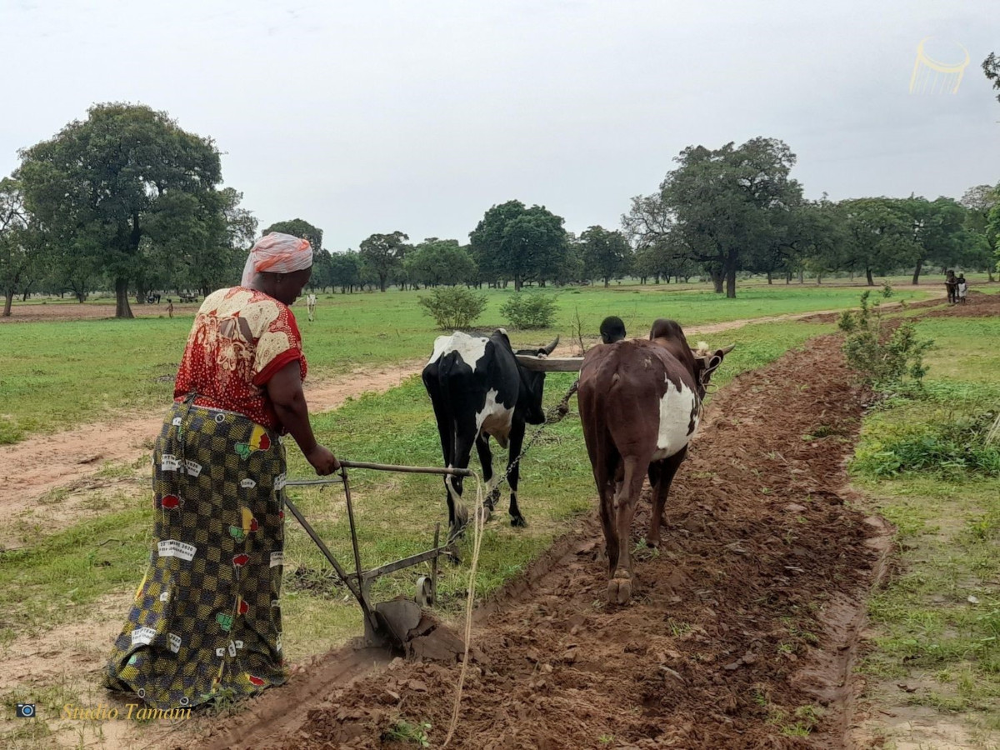
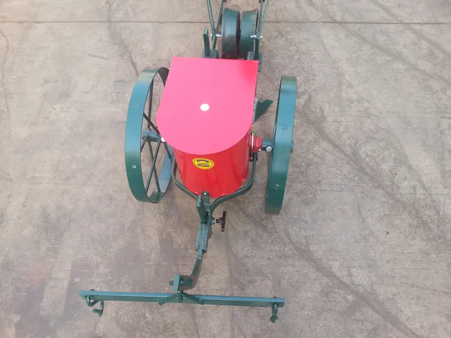
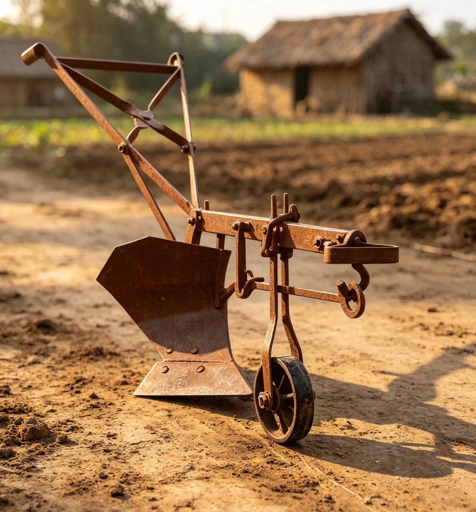
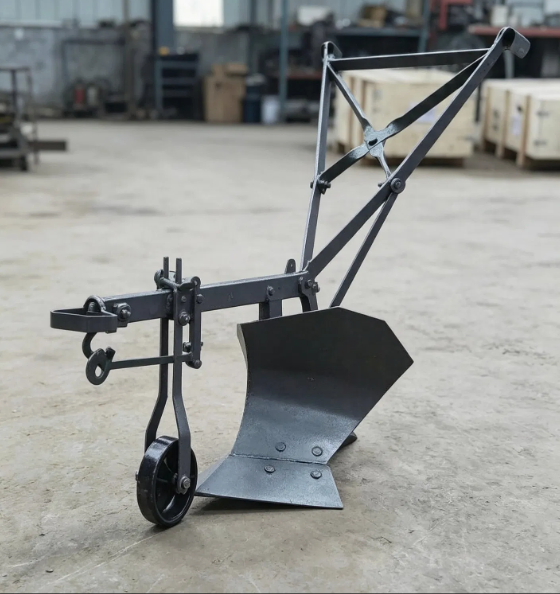
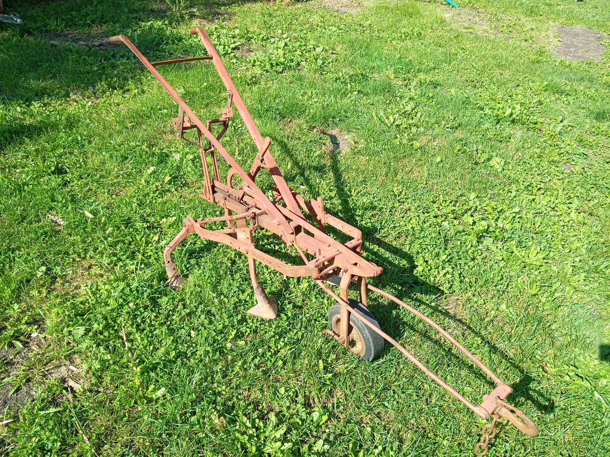
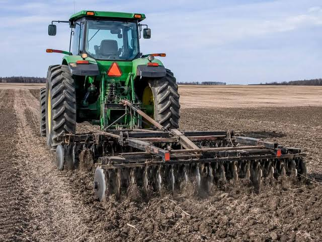
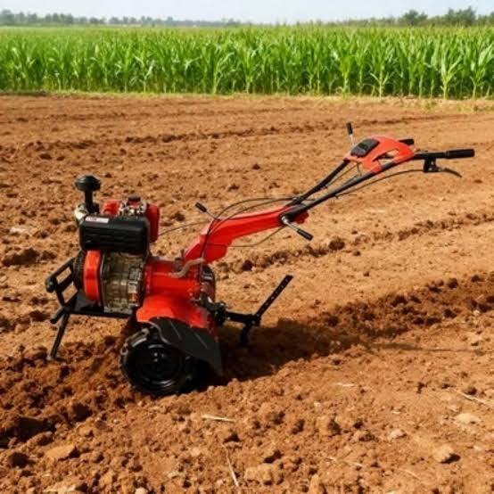
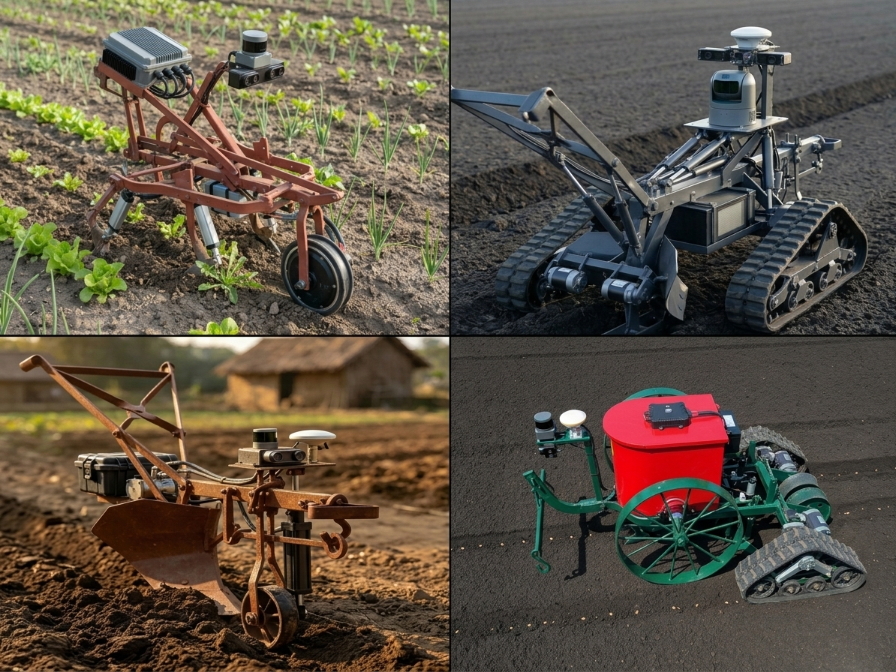

## The story

In 2024, I defended my bachelor's thesis. For my topic, I chose computer vision, agricultural robotics, and agriculture.

The goal of the thesis was to see how agribots (agricultural robots) can help us. I am the grandson and son of farmers, and I have spent time in the village, so I know how hard it is to plow, sow, ridge, and above all, farm 😂. (To "ridge" means to pile soil around the plants.)

The first time I went to the village, I did not know how to plow, sow, or ridge, but I learned. There is one man in front of the oxen and one behind. The man in front guides the oxen, and the man behind handles the machine. It is quite simple.

Here are some pictures of these machines:

## Ox plow (in my village, we call it "laboure")

The ox plow is the machine you can see below. Its role is to... hmm, just look at the picture.

_The role of the ox plow [credit: Studio Tamani]_

Can you see the woman, probably Bwa or Minianka, plowing? Now, what happens after we finish plowing hectares of land 😂? Hmm, you will say: "But Panga, we sow, of course!" And yes, you are totally right. But how do we do it? In my village, we use two ways:

- Use a tool called a seeder.
- Use a bicycle or a foot (yes, a foot, you heard right) to draw parallel lines.

I know, you will ask me to say more. Don't worry, that is what I am going to do.

- **The first way: the seeder**

_Seeder, a tool for sowing_

As you can see in the picture above, this is a seeder. It is easy to use: you open the box, put some millet in it, for example, and then welcome to work! You will understand with me why the woman's whip is so long 😂. There are two reasons. The first is the oxen, of course. The second is the man in front 😂 (that is why I preferred to be behind). You will ask me why. The reason is simple: the seeder is strict. If the man in front does not follow a straight line, everything will be mixed up, and we will end up with a badly sown field. Then the work will be hard.

- **The second way: a foot or a bicycle**

The goal is simple: we use a foot or a bicycle to draw parallel lines, and then we can easily sow along these lines.

_Ox plow_

## Ridger (in my village, we also call it "butteur" or "buttement")

This machine can be used instead of the plow, but we use it after all the other work in the field. It puts soil around the roots of the crops, so that the crops do not break, and so on. It has two "ears" 😂, while the plow has only one.

_Ridger_

## Hoe (in my village, we call it "grattement")

😂 Let me tell you a story about the hoe. One year, people from the church came to our field to help us farm. I was supposed to hoe the field before they came, so I started early in the morning. When they arrived, they first ate breakfast, and during that time, my cousin and I kept hoeing. After their breakfast, we had already hoed a big part of the field. Before 11 a.m., they had almost finished working on the part we had hoed, so we had to start again. We were tired (our hoe is so heavy compared to the others) and we did not want to continue, but we had to, so we kept going. At some point, because the field had many tree trunks and roots, the hoe sometimes got stuck. Suddenly, I saw a tree trunk and wanted to avoid it. I lifted the hoe, but it hit the trunk, bounced back, and hit my stomach hard. I threw the hoe away and threw myself on the ground, holding my stomach tightly. My uncles and everyone were worried. They thought a snake had bitten me. My uncle came close and asked me what had happened. I thought that if I told them, they would let me rest, but it had the opposite effect. They just told me to get up and keep going, saying that I was a man 😢. Do you see how hard a farmer's life is?

Now you will ask me: "But Panga, what is the role of the hoe?" Here it is. Do you remember the parallel lines I talked about? The hoe removes the weeds between these lines, to make farming easier.

_Hoe_

Okay, now you will ask me when we will talk about robotics or agricultural robots. Be patient, it is coming soon.

We have seen some machines used by farmers in the villages. Now, what about tractors 😂? Those heavy machines that suffocate our soil? Yes, those are the ones. But recently, we also have motorized machines that we can drive to plow, hoe, and so on.

## Tractor

Here is an example of a big machine that suffocates our soil. According to studies, the pressure on the deep layers of the soil (the part that is not plowed) increases as tractor tires get wider and farm machines get bigger. Their repeated passage makes the lower layers of the soil more compact.
The result: "The soil becomes less porous. Roots grow with more difficulty, water is absorbed less well, and soils become less productive."

_Tractor_

## Diesel-powered mechanical machine

Recently, we also see this kind of machine. They solve the problem caused by tractor tires, but they still emit $$ \mathrm{CO}_2 $$.

_Diesel-powered mechanical machine_

Let's go back to the title. As the title says, in my opinion, the types of agricultural robots that we Africans should use are our traditional machines, made robotic. Let me explain. On one side, we have our traditional machines. On the other side, we have mechanical machines like tractors.

The problem with the tractor is that it damages the soil, which farmers do not like. As for the diesel machine, always depending on fuel in remote villages is not a good idea. So, what should we propose? It is not enough to just propose something. It must also fit our culture, our tradition, and our reality. If we keep using these mechanical machines, in 50 years our children and grandchildren will never know that their parents and grandparents used ox plows, ridgers, seeders, and so on (they will only hear about them in stories). These machines damage our soil and release greenhouse gases, and we will also lose our culture, not to mention the fertilizers and pesticides that are slowly killing us.

So, in my opinion, the types of robots to use in Africa are the ones that reflect our reality and can preserve our identity and culture. With a single ox plow, we can plow hectares in less than a week. Now think about it: dozens of these plows, seeders, and ridgers, made robotic and working in one field, using computer vision, AI, and the latest technology. How interesting that would be!

## AI-generated image to show robotic traditional machines

_Robotic traditional machine (AI-generated)_